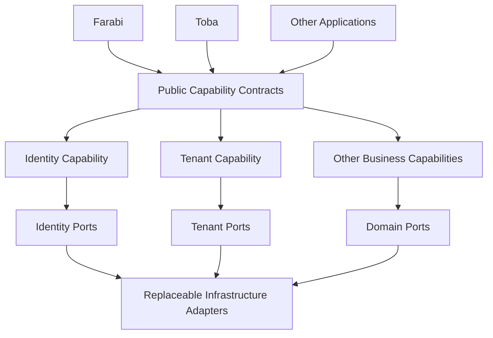
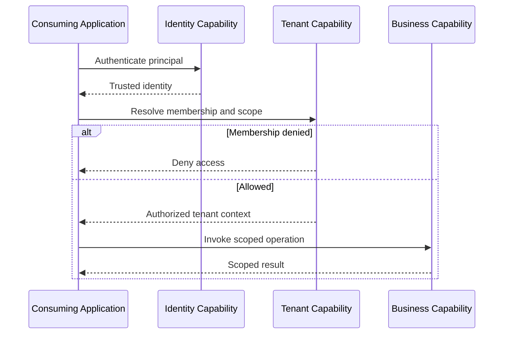
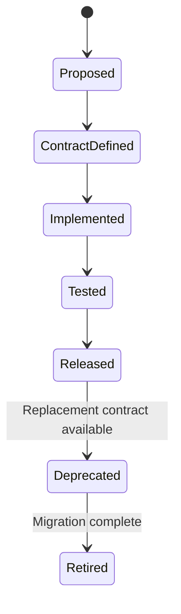

# Numou Architecture Blueprints

> Target architecture. Numou provides reusable modular business capabilities; downstream applications must not dictate its domain model.

## Capability boundaries

## Tenant-aware request sequence

## Capability evolution

## Architectural rules

- Capabilities own their domain invariants and explicit interfaces.
- Farabi/Toba integrations belong in adapters, not in Numou core.
- Avoid cross-capability database coupling and hidden shared state.
- Preserve versioning, migration, tenant isolation and independent testing.
- Prefer additive public API evolution with explicit deprecation policies.
